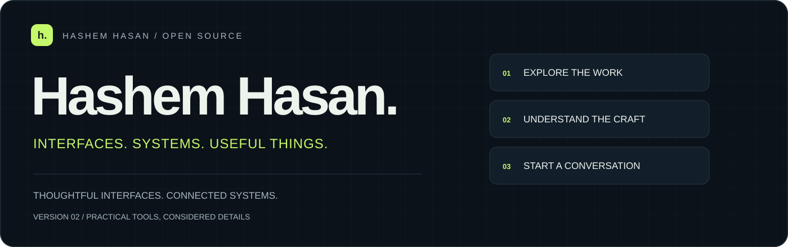
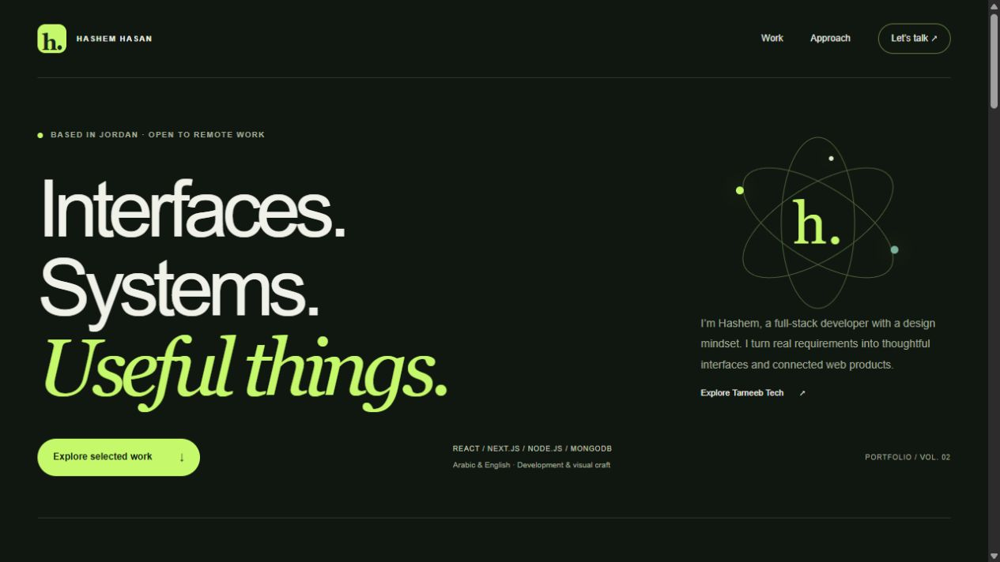
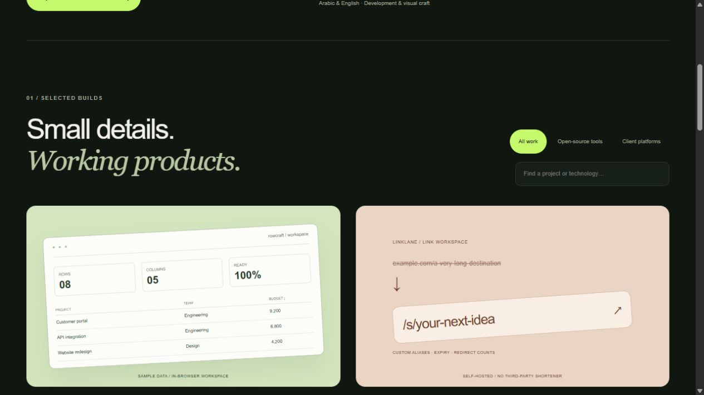

<p align="center"><picture><source media="(prefers-color-scheme: light)" srcset="./docs/hero-light.svg"></picture></p>

<p align="center"><strong>A fast, dependency-free portfolio connecting useful open-source products and selected Tarneeb Tech projects.</strong></p>
<p align="center"><a href="https://hashem-hasan.github.io/">Visit portfolio</a> · <a href="https://www.tarneebtech.com/">Tarneeb Tech</a> · <a href="https://www.linkedin.com/in/hashem-hasan">LinkedIn</a></p>



## Work you can explore

| Open-source product | What it does                                                          | Source                                                                                                      |
| ------------------- | --------------------------------------------------------------------- | ----------------------------------------------------------------------------------------------------------- |
| Rowcraft            | Local CSV/JSON sorting, search, deduplication and export              | [Data Sorter](https://github.com/Hashem-Hasan/Data-Sorter)                                                  |
| Linklane            | SQLite-backed short links, custom aliases, expiry and redirect counts | [URL Shortener](https://github.com/Hashem-Hasan/Simple-URL-Shortener-made-with-React.js-Next.js)            |
| SkyScan             | Searchable city forecasts and saved places                            | [Weather Tracker](https://github.com/Hashem-Hasan/Weather-Tracker-by-IP-made-with-React.js-and-TailwindCSS) |
| Mintline            | Financial design concept with a working savings planner               | [Banking Concept](https://github.com/Hashem-Hasan/Banking-Website-Landpage-React.js-Next.js-TailwindCSS)    |

The site also presents BPM Arabia, Janzeer Professional, Yawkeys and CipherLens, plus links to the wider portfolio. Client source stays private. Project illustrations are explicitly illustrative, not live forecast or usage data.

## A considered, lightweight experience



<table><tr><td width="50%" valign="top"><h3>Find the relevant work</h3><p>Combine project categories with text search. Announced result counts and empty states keep filtering understandable.</p></td><td width="50%" valign="top"><h3>Read it on any screen</h3><p>Responsive typography, keyboard focus, reduced-motion support, semantic landmarks and fully usable navigation.</p></td></tr><tr><td valign="top"><h3>No build step</h3><p>HTML, CSS and a small vanilla JavaScript module. No runtime dependencies or third-party trackers.</p></td><td valign="top"><h3>Keep the early chapters</h3><p>All four original HTML/CSS exercises remain available through the Foundations section.</p></td></tr></table>

## Run locally

```bash
python -m http.server 4105 --bind 127.0.0.1
```

Open [localhost:4105](http://localhost:4105). Alternatively use any static file server. To publish, configure GitHub Pages to serve `main` from the repository root. `.nojekyll` keeps the site as plain static files.

## Check the project

With Node.js 24 installed:

```bash
npm test
npm run check
```

Checks validate local assets, preserved exercise routes, project categories and essential navigation hooks. Browser verification covers combined filters and responsive rendering.

```text
index.html        Semantic, fully rendered portfolio
styles.css        Responsive visual system and project illustrations
script.js         Progressive-enhancement filters and search
project 1–4/      Original learning exercises
docs/             README banners and actual screenshots
```

---

**[Hashem Hasan](https://github.com/Hashem-Hasan)** · Based in Jordan · Open to remote work worldwide
